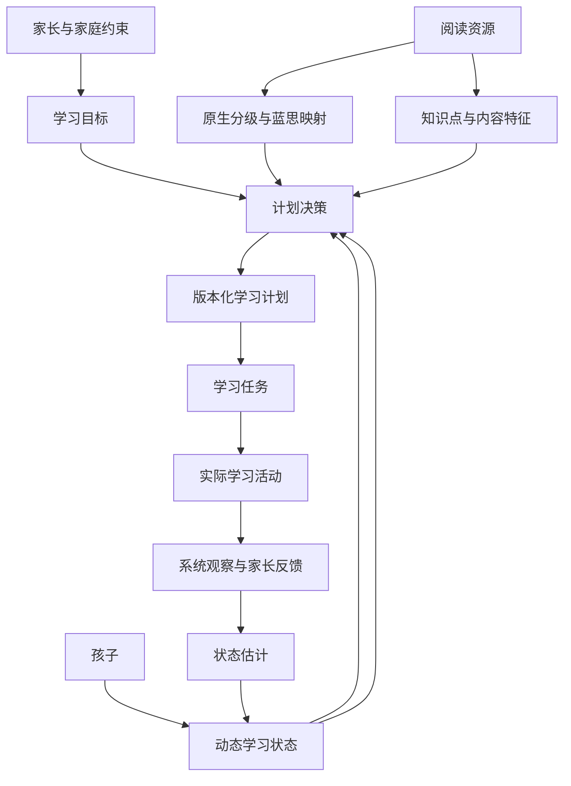
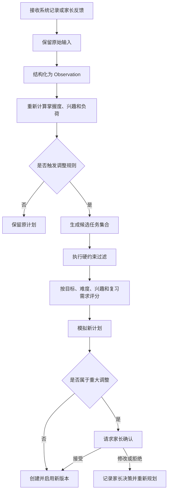

# Agentic 个性化学习领域本体设计 v0.2

> 状态：已确认 MVP 边界的讨论稿  
> 适用范围：1.5～6 岁儿童英语绘本与早期分级阅读 MVP  
> 设计原则：轻量本体、证据驱动、计划可解释、家长可干预

## 1. 设计目标

本设计为以下核心业务闭环提供统一语义模型：

1. 家长设置孩子的学习目标、使用的分级体系、可用资源和时间约束。
2. 系统根据孩子当前能力和历史表现生成滚动学习计划。
3. 孩子完成线上或线下学习，系统和家长共同提供学习证据。
4. 系统根据新证据更新能力、掌握度、兴趣和学习负荷估计。
5. Agent 在约束范围内调整后续计划，并向家长解释原因。
6. 家长可以接受、修改或否决重要调整，反馈继续成为新的决策证据。

本体在系统中承担“统一概念、关系和约束”的职责，不直接承担自然语言理解、掌握度计算或计划优化。

## 2. MVP 假设与非目标

### 2.1 已确认边界

- 目标人群为 1.5～6 岁儿童，产品必须同时适配亲子共读、听读启蒙、互动共读和早期识读。
- MVP 聚焦四个环节：现状了解、出具计划、家长反馈、学习状态更新。
- 低龄儿童不要求直接答题。主要证据来自家长观察、亲子共读行为、资源使用记录和可选的简单互动表现。
- 当前目录中的书目文本、Excel 书架和分级图片作为 MVP 的初始资源输入。
- 家长可以选择一个主学习体系，并选择零个或多个辅助体系。
- 蓝思值是跨体系比较的参考尺度，不作为唯一难度标准。
- MVP 默认采用“辅助模式”：日常小调整可以自动执行，阶段目标和明显升降级需要家长确认。
- 计划按周滚动生成，但每次学习完成后可以调整尚未执行的任务。
- 线上行为与家长提交的线下反馈都是学习证据，两者保留各自来源。
- 所有能力判断都是带时间、来源、置信度的估计，不给孩子建立永久能力标签。

### 2.2 暂不覆盖

- 开放社区、积分和内容运营体系。
- 完整课程内容生产流程。
- 基于大规模训练数据的自研知识追踪模型。
- 多学科通用学习本体。
- 一开始引入 OWL 推理机或专用 RDF 三元组数据库。
- 强制低龄儿童完成标准化测验、语音录制或阅读理解答题。
- 面向 6 岁以上学龄儿童的完整自主阅读课程和应试学习路径。

## 3. 顶层领域结构



领域划分为六个相互关联的子域：

1. **学习者域**：孩子、家庭、目标和约束。
2. **内容域**：绘本、知识点、主题和适龄信息。
3. **分级域**：各原生体系、级别和蓝思参考映射。
4. **活动与证据域**：实际发生的学习和观察证据。
5. **状态估计域**：能力、掌握度、兴趣与负荷估计。
6. **计划域**：计划版本、任务、调整建议和家长决策。

## 4. 核心概念

### 4.1 学习者域

#### Learner（学习者）

代表一个孩子，只保存业务所需的最少个人信息。

核心属性：

- `learner_id`
- `birth_year_month`：MVP 尽量不保存完整生日
- `preferred_language`
- `timezone`
- `status`
- `created_at`

#### LearnerProfile（学习者档案）

保存相对稳定、但仍可被家长修正的信息。

- `profile_id`
- `learner_id`
- `reading_experience`
- `preferred_interaction_mode`
- `notes`
- `valid_from`
- `valid_to`
- `source`

#### DevelopmentalStage（发展阶段）

年龄只是初始参考，系统以发展阶段决定交互和证据类型，避免用学龄儿童标准评价低龄儿童。

MVP 阶段建议如下。年龄范围仅用于初始引导，实际阶段由家长信息和行为证据共同判断，允许相邻阶段重叠：

- `shared_reading_emergent`：亲子共读启蒙，约 1.5～3 岁
- `shared_reading_interactive`：互动式亲子阅读，约 2.5～4.5 岁
- `early_literacy_awareness`：语音意识、文字意识和故事理解启蒙，约 3.5～6 岁
- `early_decoding`：开始识字、自然拼读或简单分级阅读，约 4.5～6 岁
- `guided_independent_reading`：少量孩子在 5～6 岁阶段出现的引导下自主阅读

阶段允许重叠，不根据生日自动强制切换。核心属性：

- `stage_id`
- `learner_id`
- `stage_type`
- `confidence`
- `based_on_observation_ids`
- `assessed_at`
- `confirmed_by_parent`

对于 1.5 岁起步阶段，系统关注的是共同注意、听读参与、图像指认、动作模仿、声音模仿、重复请求和阅读习惯，而不是独立识词量。

#### LearningGoal（学习目标）

描述一个阶段希望达成的结果，不直接等同于完成多少本书。

- `goal_id`
- `learner_id`
- `goal_type`：阅读流利度、词汇、理解、分级进阶、习惯培养等
- `description`
- `target_metric`
- `target_value`
- `start_date`
- `target_date`
- `priority`
- `status`
- `created_by`

#### LearningConstraint（学习约束）

代表家庭和产品必须遵循的边界。

- 每周可学习的日期
- 单次最短与最长时间
- 每周最大总时间
- 主学习体系和辅助体系
- 家中已有或可访问的资源
- 禁止主题或内容标签
- 最大允许难度跨度
- 自动调整权限级别

约束分为：

- `hard_constraint`：不得违反，例如内容安全、最长时长。
- `soft_preference`：尽量满足，例如优先恐龙主题。

### 4.2 内容域

#### ReadingResource（阅读资源）

- `resource_id`
- `title`
- `resource_type`
- `language`
- `publisher`
- `series`
- `edition`
- `estimated_duration`
- `cognitive_age_min/max`
- `content_safety_status`
- `metadata_source`

当前自有资产中既有单本书，也有套装、系列、级别包和杂志合集。因此资源必须拆分为三个层次：

- `ResourceCollection`：套装或系列，例如“红火箭蓝盒”。
- `ResourceEdition`：具体语言、出版社、点读版本或装帧版本。
- `ReadingItem`：可以被安排到一次学习任务中的单本或单篇内容。

在资产尚未拆到单本时，可以暂时对 Collection 排计划，但状态标记为 `needs_itemization`；要实现稳定的个性化计划，最终应逐步拆到 ReadingItem。

#### ContentFeature（内容特征）

用于描述蓝思值无法表达的阅读难度和适配因素：

- 主题：动物、恐龙、家庭、冒险等
- 文体：故事、科普、韵文等
- 篇幅
- 句式重复度
- 图片支持程度
- 背景知识要求
- 字体与排版复杂度
- 认知年龄
- 情绪和安全主题

#### LearningConcept（学习概念）

统一表示一本书可能训练或观察的知识与能力。

第一版类型：

- `phonics`：自然拼读模式
- `sight_word`：高频词
- `vocabulary`：词汇或语义类别
- `grammar`：句型和语法现象
- `decoding_skill`：解码能力
- `fluency_skill`：流利度
- `comprehension_skill`：事实、顺序、因果、推断、主旨等
- `retelling_skill`：复述与表达

核心关系：

- `broader_than` / `narrower_than`：概念层级
- `prerequisite_of`：前置关系
- `related_to`：非层级关联
- `resource_covers_concept`：资源覆盖某个概念

资源与知识点的关系应当带属性：

- `coverage_role`：主要目标、辅助目标、仅出现
- `coverage_weight`
- `expected_evidence_type`
- `source`
- `confidence`

### 4.3 分级域

#### LevelSystem（分级体系）

示例：Oxford Reading Tree、RAZ、红火箭、Lexile。

- `level_system_id`
- `name`
- `publisher_or_owner`
- `version`
- `official_source`
- `usage_rights_status`

#### NativeLevel（原生级别）

- `native_level_id`
- `level_system_id`
- `code`
- `display_name`
- `ordinal`
- `description`

#### ResourceLevelAssignment（资源分级声明）

表达“某个版本的某本书在某体系中被标记为什么级别”。

- `resource_id`
- `native_level_id`
- `assignment_type`：官方、出版社、平台推定、用户提交
- `source_reference`
- `confidence`
- `verified_at`

#### LevelMapping（分级映射）

分级映射必须作为独立实体，不能用一条无来源的等号关系表达。

- `source_level_id`
- `target_system_id`
- `target_min_value`
- `target_max_value`
- `mapping_relation`：近似、重叠、包含、官方对应
- `method`
- `source_reference`
- `confidence`
- `version`
- `valid_from/to`

蓝思值只作为映射目标之一。选书时还必须考虑资源原生级别、内容特征和孩子实际表现。

### 4.4 活动与证据域

#### LearningActivity（学习活动）

表示实际发生过的一次学习，而不是计划中的任务。

- `activity_id`
- `learner_id`
- `task_id`：允许为空，支持计划外学习
- `resource_id`
- `activity_type`：家长朗读、亲子共读、孩子自主翻阅、点读、唱游、跟读、新读、复习、测评
- `started_at`
- `ended_at`
- `completion_status`
- `interaction_mode`

#### Observation（观察证据）

所有状态估计都必须能够追溯到观察证据。

- `observation_id`
- `activity_id`
- `subject_type/id`：所观察的知识点、能力或整体任务
- `dimension`：正确率、提示依赖、流利度、兴趣、疲劳等
- `value`
- `value_type`
- `source_type`：系统、家长、孩子自评、教师
- `source_id`
- `observed_at`
- `confidence`
- `raw_reference`：原始反馈、答题记录或音频分析结果的引用
- `supersedes_observation_id`：纠错时追加新记录，不覆盖旧记录

低龄阶段优先使用以下观察维度：

- `joint_attention`：是否能与家长共同关注页面或内容
- `engagement`：参与程度
- `attention_duration`：大致持续时间
- `page_interaction`：主动翻页、触摸、寻找机关
- `pointing_response`：听到提示后是否指认图片或对象
- `action_imitation`：是否模仿动作
- `sound_or_word_imitation`：是否模仿声音或词语
- `receptive_response`：是否对熟悉词句作出恰当反应
- `repeated_request`：是否主动要求再读或重复播放
- `avoidance_or_distress`：回避、烦躁或明显抵触
- `caregiver_support`：家长需要提供的支持程度

这些观察只描述当前行为证据，不直接推断孩子的智力、性格或永久语言能力。

#### ParentFeedback（家长反馈）

保留原文和结构化解释：

- `feedback_id`
- `activity_id`
- `original_text`
- `completion`
- `perceived_difficulty`
- `independence_level`
- `interest_level`
- `fatigue_level`
- `difficult_concept_ids`
- `structured_by_model`
- `model_confidence`
- `confirmed_by_parent`

家长反馈被结构化后生成一条或多条 Observation，但不得删除原始反馈。

### 4.5 状态估计域

#### MasteryEstimate（掌握度估计）

表达“根据当前证据，系统认为孩子对某项知识或能力掌握到什么程度”。

- `estimate_id`
- `learner_id`
- `concept_id`
- `score`：建议内部使用 0～1 连续值
- `state`：未观察、初学、巩固中、基本掌握、稳定掌握
- `confidence`
- `calculated_at`
- `model_version`
- `evidence_ids`
- `expires_or_review_at`

第一版可以采用可解释加权规则：

```text
新掌握度 = 历史掌握度的时间衰减
          + 独立正确表现权重
          + 迁移任务表现权重
          - 提示依赖权重
          - 近期错误权重
```

具体权重属于算法配置，不写死在本体中。

#### ExposureEstimate（接触与熟悉度估计）

对于尚不适合用“掌握度”描述的低龄儿童，优先记录接触和熟悉程度：

- `learner_id`
- `target_id`：绘本、主题、词语、童谣或互动模式
- `exposure_count`
- `last_exposed_at`
- `familiarity_state`：首次接触、熟悉中、表现出预期、主动参与、稳定偏好
- `response_types`
- `confidence`
- `evidence_ids`

`ExposureEstimate` 不等于 `MasteryEstimate`。例如，孩子多次主动要求播放某首童谣，只能说明熟悉或偏好，不能单独证明理解了其中词汇。

#### InteractionCapabilityEstimate（互动能力估计）

记录孩子在适龄共读互动中的当前表现，例如共同注意、指认、模仿、简单回应和自主翻阅。该估计用于选择互动方式，不用于医学或发育诊断。

#### InterestEstimate（兴趣估计）

按主题或内容类型保存短期与长期兴趣：

- `target_feature_id`
- `short_term_score`
- `long_term_score`
- `confidence`
- `evidence_ids`
- `calculated_at`

#### LearningLoadEstimate（学习负荷估计）

- 建议单次时长
- 当前任务的主观难度
- 疲劳风险
- 提示依赖程度
- 最近连续失败或中断次数

兴趣低、能力不足和身体疲劳必须分别建模，不能都归结为“不会”。

### 4.6 计划域

#### LearningPlan（学习计划）

- `plan_id`
- `learner_id`
- `goal_ids`
- `period_start/end`
- `current_revision_id`
- `status`

#### PlanRevision（计划版本）

任何动态调整都生成新版本，不修改历史版本。

- `revision_id`
- `plan_id`
- `revision_number`
- `created_at`
- `trigger_type`
- `trigger_evidence_ids`
- `change_summary`
- `requires_parent_confirmation`
- `decision_status`

#### LearningTask（学习任务）

- `task_id`
- `revision_id`
- `task_type`
- `resource_id`
- `target_concept_ids`
- `scheduled_date`
- `suggested_duration`
- `difficulty_role`：巩固、适读、挑战
- `sequence`
- `status`
- `recommendation_reasons`

#### PlanAdjustment（计划调整）

- `adjustment_id`
- `from_revision_id`
- `to_revision_id`
- `operation`：新增、删除、改期、替换、缩短、升降难度
- `affected_task_ids`
- `reason_codes`
- `supporting_evidence_ids`
- `policy_rule_ids`
- `explanation`
- `initiated_by`
- `approved_by`

## 5. 核心关系摘要

| 主体 | 关系 | 客体 | 关系说明 |
|---|---|---|---|
| Learner | hasGoal | LearningGoal | 一个孩子可以有多个有优先级的目标 |
| Learner | hasConstraint | LearningConstraint | 约束计划边界 |
| ReadingResource | assignedNativeLevel | NativeLevel | 保留原生体系身份 |
| NativeLevel | mappedBy | LevelMapping | 映射带来源、版本和置信度 |
| ReadingResource | covers | LearningConcept | 带覆盖角色和权重 |
| LearningConcept | prerequisiteOf | LearningConcept | 支撑知识路径 |
| LearningTask | uses | ReadingResource | 计划使用的材料 |
| LearningTask | targets | LearningConcept | 本任务训练或观察的目标 |
| LearningActivity | realizes | LearningTask | 实际活动可实现某个计划任务 |
| Observation | generatedFrom | LearningActivity | 证据来源可追溯 |
| MasteryEstimate | basedOn | Observation | 估计必须有证据 |
| PlanRevision | triggeredBy | Observation | 调整原因可追溯 |
| PlanAdjustment | governedBy | PolicyRule | 记录采用的规则 |
| ParentDecision | accepts/rejects | PlanAdjustment | 家长保留控制权 |

## 6. 动态计划决策流程



### 6.1 候选资源评分框架

```text
candidate_score =
    goal_match
  + difficulty_fit
  + review_need
  + interest_fit
  + primary_system_continuity
  + resource_availability
  - difficulty_jump_risk
  - recent_content_repetition
  - fatigue_risk
```

先执行硬约束过滤，再进行软评分。大模型不能绕过硬约束。

### 6.2 第一版调整规则示例

#### R-001 连续偏难

```text
IF 最近 3 次活动中至少 2 次：
   caregiver_perceived_fit IN [too_complex, not_engaging]
   AND engagement IN [low, avoidance]
THEN
   暂停增加文本、时长或互动复杂度
   优先更换为更短、图像支持更强或互动形式更熟悉的资源
   区分疲劳、题材不感兴趣和内容复杂度
```

#### R-002 持续偏易

```text
IF 最近 4 次活动持续高参与
   AND 出现稳定的预期、指认、模仿或主动重复行为
   AND 没有明显疲劳或抵触信号
THEN
   保留熟悉内容
   加入 1 个轻微扩展任务或新的互动方式
   不仅凭兴趣表现推断语言掌握
```

#### R-003 兴趣替换

```text
IF 能力表现正常
   AND 某主题连续出现低兴趣或抵触
THEN
   保留目标知识点和难度
   优先替换主题而非降低级别
```

#### R-004 未完成任务

```text
IF 任务未完成
THEN
   根据原因分别处理：
   时间冲突 -> 重排本周剩余任务
   任务过长 -> 拆分任务
   难度过高 -> 安排前置巩固
   兴趣不足 -> 同目标换主题
   原因未知 -> 请求低成本补充反馈
```

#### R-005 证据冲突

```text
IF 系统证据与家长反馈明显冲突
THEN
   不覆盖任一证据
   降低相关状态估计置信度
   安排不同形式的短任务复核
   不进行明显升降级
```

#### R-006 低龄重复阅读

```text
IF 孩子主动要求重复某本书、童谣或页面
THEN
   提高短期兴趣与熟悉度估计
   保留适量重复任务
   下一次仅增加一个微小互动目标
   不因为“已经读过”自动移出计划
```

## 7. Agent 的职责和工具边界

### 7.1 Agent 可以做什么

- 将家长自然语言反馈转换为结构化候选数据。
- 查询学习者状态、当前计划和相关证据。
- 请求计划引擎生成或模拟调整方案。
- 向家长解释推荐和调整原因。
- 在授权范围内创建日常小调整。
- 对重大调整请求家长确认。

### 7.2 Agent 不可以做什么

- 直接覆盖原始学习记录或家长反馈。
- 绕过规则服务直接写入掌握度。
- 编造绘本级别、蓝思值或资源内容。
- 在没有证据的情况下给孩子建立固定能力标签。
- 超过家长设置的时间、内容和自动化边界。
- 独立决定明显升降级或改变阶段目标。

### 7.3 MVP 工具接口

```text
get_learner_profile(learner_id)
get_learning_state(learner_id, dimensions?)
get_active_goals_and_constraints(learner_id)
get_current_plan(learner_id)
get_supporting_evidence(estimate_or_adjustment_id)

record_parent_feedback(activity_id, original_text, structured_candidate)
confirm_structured_feedback(feedback_id, correction?)

search_resources(criteria)
simulate_plan_adjustment(learner_id, trigger_ids)
create_plan_revision(simulation_id)
submit_adjustment_for_parent_decision(adjustment_id)
record_parent_decision(adjustment_id, decision, comment?)
```

写操作必须由业务服务再次校验身份、数据类型、约束和权限。

## 8. PostgreSQL 落地建议

### 8.1 MVP 核心表

```text
learner
learner_profile
developmental_stage
learning_goal
learning_constraint

source_document
raw_resource_record
resource_normalization_candidate
level_system
native_level
resource_collection
resource_edition
reading_item
resource_level_assignment
level_mapping

content_feature
learning_concept
concept_relation
resource_feature
resource_concept

learning_plan
plan_revision
learning_task
learning_activity

parent_feedback
observation
exposure_estimate
interaction_capability_estimate
mastery_estimate
interest_estimate
learning_load_estimate

policy_rule
plan_adjustment
parent_decision
```

### 8.2 存储原则

- 原始事件、反馈和观察采用追加式记录。
- 估计结果允许按新算法重新计算，但保留模型版本。
- 每次计划调整创建新版本，已完成任务不可被改写。
- 重要业务关系使用明确关联表，不把所有内容塞入 JSON。
- 变化快、不同证据类型差异大的附加属性可以使用 JSONB。
- 语义检索确有需要时增加 `pgvector`，不将向量作为事实来源。
- 所有外部数据记录来源、许可证状态、版本和更新时间。

### 8.3 暂不引入图数据库的原因

MVP 的主要查询是按孩子、时间、计划和资源筛选，PostgreSQL 足以支持。出现以下情况后再评估 Neo4j 或 RDF 存储：

- 前置知识和内容关系出现大量多跳查询；
- 跨体系映射关系变得非常复杂；
- 关系推理成为主要性能瓶颈；
- 需要与外部教育知识图谱进行标准化互操作。

## 9. 当前资源资产审计

### 9.1 已发现资产

| 文件 | 当前作用 | 数据质量判断 | MVP 使用方式 |
|---|---|---|---|
| `工作簿1.xlsx` | 已整理的家庭书架 | 结构化程度最高，但缺少单本拆分、蓝思值和出版社等信息 | 作为初始书架主数据导入 |
| `已有的图书.txt` | 采购与收藏流水 | 条目更多，包含价格、渠道、售出状态、简称和重复记录 | 作为待清洗的补充来源，不直接覆盖 Excel |
| `启蒙分级1.jpg` | 跨体系分级及书单参考 | 图片来源和映射方法尚未核验 | 保存为第三方参考资料，人工确认后再形成映射 |
| `启蒙分级2.jpg` | RAZ、牛津树、红火箭等分级对照 | 图片来源和映射方法尚未核验 | 保存为第三方参考资料，不能标记为官方映射 |

### 9.2 Excel 书架概况

当前工作簿共有 66 条书目或套装记录：

- 语言：英文 41、中文 17、双语 3、未填 5。
- 类型：故事 26、认知 14、小分级 7、童谣 5，其余为科普、国学、杂志、单词、游戏和未填记录。
- 适龄：1+ 有 16 条、1.5+ 有 15 条、2+ 有 24 条、3+ 有 5 条、4+ 有 2 条、未填 4 条。
- 点读：小彼恩 40、非点读 15、小蝌蚪 5、小怪兽 1、未填 5。
- 66 条记录的蓝思值目前均为空。

这些数据足以验证“基于家庭已有资源出计划”，但还不足以直接验证精确的跨体系难度推荐。

### 9.3 数据导入本体

资源入库分为四层，避免自动清洗覆盖原始资料：

1. `SourceDocument`：源文件、图片或人工录入批次。
2. `RawResourceRecord`：从源中提取的一条原始记录，保持原文。
3. `ResourceNormalizationCandidate`：Agent 给出的标准化候选，包括书名、语言、系列、版本、年龄和可能的重复项。
4. `CanonicalResource`：经规则或家长确认后使用的标准资源。

核心溯源字段：

- `source_document_id`
- `source_locator`：Excel 行号、文本行号或图片区域
- `raw_value`
- `normalized_value`
- `normalization_method`
- `confidence`
- `confirmed_by`
- `confirmed_at`

### 9.4 合并和冲突规则

- Excel 和文本出现相似书名时先建立 `possible_same_as`，不自动合并。
- 售出、未购买或赠送等状态从备注中提取为候选，由家长确认是否仍在家庭书架。
- 套装与单本不得当作同一层级资源合并。
- 年龄字段表示资源建议年龄，不等于孩子当前适读能力。
- 图片中的分级映射标记为 `third_party_reference`，除非后续找到可验证的官方来源。
- 蓝思值为空时保留为空，不根据图片范围给单本伪造精确蓝思值。

## 10. 1.5 岁儿童的典型数据示例

家长输入：

> 今天读《From Head to Toe》大约 8 分钟。读到动物动作时会跟着做，连续要求读了两遍，后面开始自己翻页，没有跟着说单词。

结构化反馈候选：

```json
{
  "completion": "completed",
  "duration_minutes": 8,
  "engagement": "high",
  "repeated_request": true,
  "action_imitation": "observed",
  "page_interaction": "independent_page_turning",
  "sound_or_word_imitation": "not_observed",
  "caregiver_support": "read_aloud_and_model_action",
  "model_confidence": 0.91
}
```

业务服务生成的观察：

```json
[
  {
    "dimension": "action_imitation",
    "subject": "resource:from_head_to_toe",
    "value": "observed",
    "source_type": "parent"
  },
  {
    "dimension": "repeated_request",
    "subject": "resource:from_head_to_toe",
    "value": 2,
    "source_type": "parent"
  },
  {
    "dimension": "sound_or_word_imitation",
    "subject": "activity",
    "value": "not_observed",
    "source_type": "parent"
  }
]
```

状态与计划更新：

```text
提高该书和“身体动作”主题的短期熟悉度与兴趣估计；
不把“未跟说单词”记录为失败或能力下降；
两天内保留一次重复阅读；
下次只增加一个互动目标：家长暂停并等待孩子主动做一个熟悉动作；
继续把单次建议时长控制在 5～10 分钟。
```

调整理由必须引用具体 Observation 和规则编号，而不是只保存自然语言解释。

## 11. 产品决策状态

### D-001 目标年龄范围：已确认

目标人群为 1.5～6 岁。系统采用发展阶段模型，不用固定年龄统一决定计划和评价方式。产品覆盖亲子共读启蒙、互动共读、早期识读，以及少量孩子在 5～6 岁出现的引导下自主阅读。

### D-002 主学习体系与混合规则：暂定

默认允许家长选择一个主体系维持连续性，辅助体系用于同难度巩固、兴趣拓展和知识点补充。

在 1.5 岁启蒙阶段，计划可以先以绘本、童谣、认知主题和亲子互动形式为主，不强制进入某个分级体系。

### D-003 MVP 学习闭环：已确认

MVP 只聚焦：

1. 现状了解；
2. 出具计划；
3. 家长反馈；
4. 学习状态更新并迭代计划。

不要求孩子直接答题，不把语音分析作为首版依赖。

### D-004 自动调整权限：采用默认值

- 自动：重复安排、改期、同复杂度换主题、小幅调整时长和互动方式。
- 家长确认：发展阶段变化、明显提高内容复杂度、每周总时长增加、切换主体系。

### D-005 家长反馈负担：针对低龄重新定义

每次活动默认只需要：

- 是否进行；
- 大致时长；
- 参与表现。

家长可以快速补充指认、模仿、主动重复、抵触等行为，也可以直接输入自然语言，由 Agent 提取候选观察。

### D-006 内容资源边界：已确认

MVP 使用当前目录中的文本、图片和 Excel 自有资源。系统首先完成元数据管理和计划，不假设拥有完整电子绘本内容版权。

### D-007 分级数据来源：采用保守策略

来源等级为：官方、出版方、第三方参考、平台估算。当前两张图片暂定为第三方参考；在来源核验前，不据此宣称官方对应关系。

## 12. 建议的验证场景

本体和计划机制至少通过以下端到端场景验证：

1. 1.5 岁孩子主动要求重复同一本书，系统保留重复而不是机械换新。
2. 孩子参与动作模仿但没有说词，系统更新互动与熟悉度，不错误记录为词汇失败。
3. 家长报告后半段烦躁，系统区分时长过长、题材不适合和内容复杂度。
4. 同一本书在 Excel 与文本中名称不同，系统提示可能重复但不直接合并。
5. 套装只有系列级信息，计划允许暂用套装，但提示逐步补充单本清单。
6. 家长反馈临时没有学习，系统改期而不记录能力下降。
7. 孩子进入明确分级阅读阶段后，系统以家长选择的主体系维持连续性，并用其他体系做补充。
8. 图片对照表与后续官方来源冲突时，官方信息生效并保留旧映射的来源记录。

## 13. 下一步设计顺序

1. “现状了解”问卷与状态输出已形成独立设计稿：`现状了解模块设计-v0.1.md`。
2. 首周计划与动态调整已形成独立设计稿：`首周学习计划与动态调整设计-v0.1.md`。
3. Excel 和文本已转换为不覆盖源文件的标准化候选书架：`outputs/agentic-bookshelf-20260917/现有资源标准化候选书架-v0.1.xlsx`。候选记录保留来源定位；疑似重复不自动合并；“已出/卖出/送人”仅作为待确认信号。
4. 为验证场景编写输入、状态变化和计划输出验收用例。
5. PostgreSQL ER 模型已落地：`db/schema-v0.1.sql`，并形成关系与受控 Agent 闭环图：`diagrams/mvp-er-agent-loop.svg`。
6. 资源添加、状态上下文、家长反馈、计划调整、并发与幂等契约已形成独立设计稿：`PostgreSQL-ER与Agent工具契约-v0.1.md`。
7. 实现第一版可解释规则，而后接入 Agent 工具调用。
