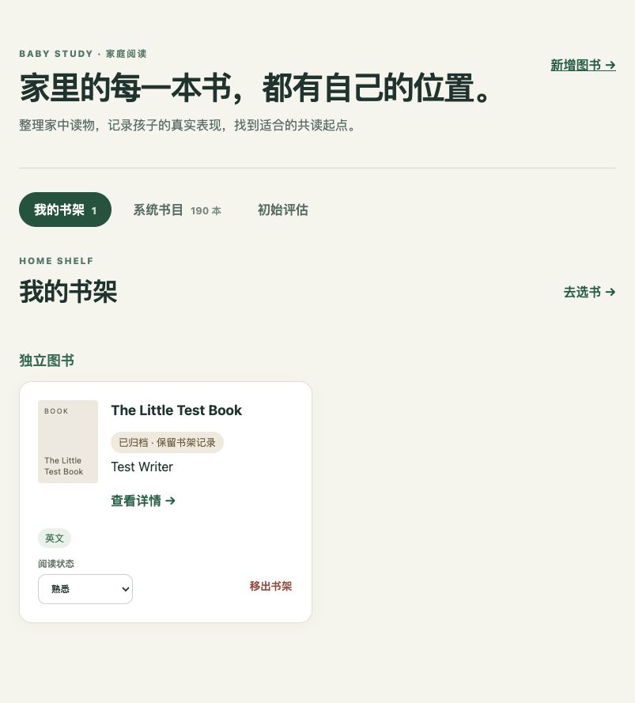

# 004 集成验收记录

2026-09-29，Spec 基线 v0.5；状态 **in-progress**。代码基线 `f3cb81d`，六个功能任务独立提交后由主会话集成。以下明确区分真实调用、固定样本和未执行项。没有把供应商文档、模拟响应或代码存在当作真实调用成功。

## 真实 MiMo 联调

服务端使用用户提供的实时与中国区 Batch 地址，模型为 `mimo-v2.6-flash`。凭据仅从用户指定的文件读取并放入忽略的 `.env`，不记录在本报告。

| 能力 | 输入与结果 | 输入 / 输出 / 总 tokens | 时间 |
| --- | --- | --- | --- |
| 文字 | 简短验证提示，返回 `OK` | 21 / 2 / 23 | 1.68 秒 |
| 图片 | 合成图书照片，JSON 正确提取 The Little Test Book、Test Writer | 623 / 18 / 641 | 3.14 秒 |
| 音频 | 本地合成短语音，理解为 “This is a short test. I read a book today.” | 41 / 13 / 54 | 1.90 秒 |
| 实时图书录入 | 前台多选两张合成照片，经真实 worker 提取并归为一组；未知 ISBN 留空，模型明确提示合成样本疑点 | 2,174 / 308 / 2,482 | 后台异步处理 |

样本明确标注 MODEL VALIDATION SAMPLE / Synthetic fixture，未用用户私人照片或家长语音。后三模态能力只验证适配和代表输入，不承诺实物书识别准确率或完整 Agent 行为。三类实时共用网关可供后续 Agent 调用，本期没有 Agent 聊天或录音交互界面。

这四项记录合计 3,200 tokens；若全部输入按未命中缓存计算，按当日国内 Flash 实时价目约为 ¥0.003541，仅为这些返回记录的估算，不是已核对账单。页面分别显示实际返回用量及覆盖项费用估算；两图记录对应实时约 ¥0.002790，相同用量按 Batch 价目约 ¥0.001395。Batch 的实际用量尚未返回，不以零计费表达。[MiMo 计费与 Batch 说明](https://mimo.mi.com/docs/zh-CN/quick-start/usage-guide/text-generation/batch-api)

服务端价目核验日期为 2026-09-29，国内 Flash 输入/输出为 1/2 元每百万 tokens，Pro 为 3/6 元，Batch 为对应实时价目的一半。`MIMO_COST_PRICING_REGION=cn` 时使用该人民币价目，设置为空/其他地域时不估算。所有输入按未命中缓存计算；只包含有效返回输入/输出用量且型号已知的照片，不把未完成、缺失用量和未知型号当作零。该覆盖项估算不包含所有失败/重试消耗，不能称为任务总费用或最终账单。[官方国内价目](https://mimo.mi.com/docs/zh-CN/quick-start/usage-guide/text-generation/batch-api)

新增 9 项费用/API 回归通过：实时与 Batch 单价、缺失/未知覆盖、真实零用量、非法计数、缓存计价假设、Pro 型号、关闭人民币估算及序列化分离。前台任务使用离线 SSR 验证 null/0/小额金额、最多 8 位小数、覆盖项/通道/日期/来源和保留 tokens；这些是固定输入渲染验证，没有新增真实付费调用。

## 真实 Batch 尚未完整验收

实际成功上传 JSONL、创建任务并查询状态：

- 单图最小样本：`batch_e1fcd58decfc4a529564d82f`，输入文件 `file-210c173f3973`。
- 前台两图任务：本地 Intake `4a8c53dc-dd17-494b-b57d-c72cf1df9038`，供应商 `batch_371142787dc34098ab3beca4`，输入文件 `file-29a890aa1a83`。
- 两个任务截至 2026-09-29 14:35 中国时间查询均为 `validating`，没有输出/错误文件；提交返回的 `24h` 窗口已被接口接受。

真实结果下载及多图实际回填 **未验证**，AC-005 保持未完整通过。供应商采用闲时调度，任务可能延迟；本地不重复提交，也不静默切换实时。当前 worker 每 60 秒查询本地两图任务，重启后继续使用已保存 ID。[供应商调度与状态说明](https://mimo.mi.com/docs/zh-CN/quick-start/usage-guide/text-generation/batch-api)

固定样本已验证乱序映射、成功/错误文件、缺失结果、部分失败、仅重试失败项、输出下载失败后的再次查询、取消后迟到结果、首次提交即终态、已知 ID 的不确定提交协调、重启和旧租约 fencing。它们不能替代上述真实下载。

两图验收任务保留在禁用的临时账户下，仅用于后续主会话核对。原始媒体仍按 30 天规则清理。最小单图样本直接提交，没有写入业务表；脱敏本地查询脚本和响应保留在 `/tmp/baby-study-ai-validation/`，不是长期交付依赖。下一次主会话核对可从 `IntakeBatch.provider_batch_id` 或上述 ID 继续查询，禁止重新提交相同样本充当进度。

## 真实前台和联网流程

主会话在 `http://127.0.0.1:5174` 使用临时管理员，调用真实 Django/PostgreSQL 后端；5173 被另一项目占用，未停止该项目。

- 默认 Batch、实际文件选择器多选、两张照片上传、私有缩略图、任务列表及持久化 ID 通过。明确选择实时后，两张照片识别为一条草稿。
- 刷新页面及重启后端后，草稿和字段来源仍可恢复。修改出版社后保存，再统一确认；确认前共享书目未增加，确认后任务只读。
- 明确勾选书架选项后加入临时书架；归档后活动目录减少，已有阅读状态保持。拥有者可继续查看归档详情、更新阅读状态至 familiar；他人不能新增归档书。
- 手工新增 UI Manual Test Book 成功，未勾选书架时不自动拥有。
- 实际 Open Library ISBN `9780140328721` 查到版本 `OL7353617M` / Fantastic Mr. Fox，返回 10 条来源；无 ISBN 的书名/作者检索返回 3 个具体版本候选，包含不同标题/合集，须逐一核对。
- 前台联网验收草稿中，查询不自动填作者/出版社；只勾选作者并应用、保存后作者为 Roald Dahl，出版社仍为空。保存了版本页与作者页的真实声明，没有把作者页改写为支持其他姓名。
- 公开书目直连发生连接超时；通过显式服务器 `INTAKE_ENRICHMENT_PROXY_URL` 后真实查询成功。配置仅作用于公开书目，不继承 `.netrc` 或发送 MiMo 凭据。未配置/来源不足/失败均可继续手工录入。
- 390px 窄屏无页面横向溢出；已有导航允许自身横向滚动。照片文件入口的 `multiple` 与相机 `capture` 已实现；**未操作真实手机硬件相机**。

前端任务另使用固定响应验证合并、拆分、移入/未归属、已有版本选择与修改后清空、409 保留本页修改、逐字段联网选择、键盘焦点和确认后只读；8 次固定样本变更请求均带 CSRF。这些结果来自功能任务，不冒充真实供应商输入。



窄屏与联网候选截图：[上传页面](validation-assets/mobile-upload.png)、[联网来源](validation-assets/web-candidate.png)。均为合成验收数据或公开书目候选，无凭据和用户私人资料。

## 检查与回归

完整 Django 测试从 `backend/` 运行，覆盖迁移、权限/CSRF/隔离、书架/评估、书目管理、模型网关、分组、联网和 worker。最终结果与命令：

```sh
# 在根目录加载未跟踪 .env 后
.venv/bin/ruff check backend
.venv/bin/ruff format --check backend
.venv/bin/python backend/manage.py check
.venv/bin/python backend/manage.py makemigrations --check --dry-run
# 在 backend/ 中
../.venv/bin/python manage.py test --noinput
# 在 frontend/ 中
npm run lint
npm run format:check
npm run typecheck
npm run build
```

最终 257 项后端测试通过；Ruff/Django 检查和前端 lint/format/typecheck/build 通过；`git diff --check` 通过。迁移 0007/0008/0009 已应用，无模型迁移缺口。0009 为 worker 租约 token，旧执行者不能更新结果或清除新执行者租约；已有 Batch ID 不变。

集成审查修正来源粒度、OCR 文本大小写、合并/拆分后的可信照片来源、先锁目录再锁用户的事务顺序、归档书架兼容、初始终态及不确定提交协调。后续独立复核因任务配额中断，主会话完成对应回归和全套测试；不声称做过额外完整安全审计。

扫描跟踪文件与前端构建产物未发现实际 API Key，API_KEY/.env 未被跟踪。原始 191 个 Book ID、已有书架及 AssessmentSession 快照与验收前一致。临时新增的两本合成书、临时书架、手工导入账本和非 Batch 验收草稿已清理；临时账户已禁用并清除可用密码，只保留待返回的 Batch 任务。

## AC 对应结果

| 验收项 | 当前结果及限制 |
| --- | --- |
| AC-001 | 管理员前台新增/归档，非管理员 API 拒绝及 CSRF 测试通过；入口能力控制和固定 UI 通过 |
| AC-002 | 无引用/书架/多系列归档回归通过，真实归档保留状态通过；原评估快照不变 |
| AC-003 | 合成封面/版权页实际两图归组、缺字段/错误 ISBN/版本固定样本通过；用户实物照片未验证 |
| AC-004 | 真实文字/图片/短音频通过，脱敏用量已记录；无 Key 离线与手工路径通过 |
| AC-005 | **未完整通过**：真实提交/查询通过，真实结果下载待供应商文件；映射/取消/部分失败离线通过 |
| AC-006 | 用户确认后的六任务创建、公共契约、worktree、提交与主会话集成通过 |
| AC-007 | 登录/CSRF/跨用户媒体、凭据扫描及原书架/评估快照通过 |
| AC-008 | 照片/网页/人工来源、子列表粒度、人工修改、版本/ISBN/幂等回归通过 |
| AC-009 | 不要求预分组，统一确认前不入库；真实可选书架及原子确认回归通过 |
| AC-010 | 有/无 ISBN 真实来源、前台选择字段通过；冲突/不足/失败固定样本通过，来源仅 Open Library |
| AC-011 | 持久化、重启、费用通道限制、大小/清理、返回用量及覆盖项金额估算通过；日期/来源/假设/账单区别明确，缺失 tokens 不视为零 |
| AC-012 | 36 项识别/分组固定样本及纠正来源回归通过；单张多本提示需重拍，不自动拆书 |

因此 Spec/Plan/索引保持 `in-progress`。待完成：真实 Batch 输出下载及回填、手机真机/实物照片质量验证；不从已有实现反推这些项已完成。后续更换地域/型号/价目须重新核验金额假设，不自动以现有人民币表套算。
