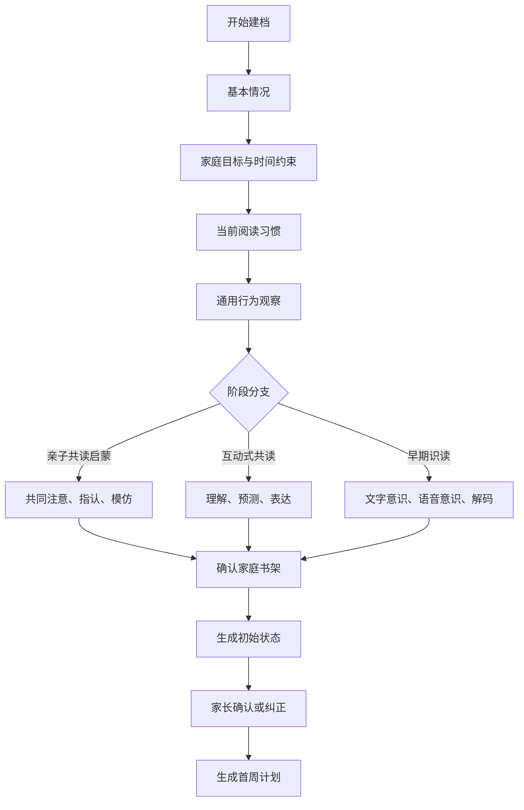

# 现状了解模块设计 v0.1

> 适用范围：1.5～6 岁儿童英语绘本与早期分级阅读 MVP  
> 目标用时：首次建档 5～8 分钟  
> 核心产出：可解释的初始学习状态与首周计划输入

## 1. 模块目标

“现状了解”不是一次英语考试，也不输出单一的“英语等级”。它需要帮助系统回答以下问题：

1. 孩子目前主要以什么方式接触英语绘本？
2. 孩子当前适合怎样的共读或早期识读互动？
3. 家庭能够稳定投入多少时间？
4. 孩子表现出哪些兴趣、熟悉行为和初步能力？
5. 家长希望优先解决什么问题？
6. 家庭拥有哪些可以立即使用的资源？
7. 第一周应该从什么内容、时长和互动强度开始？

模块输出是一个带证据与置信度的 `InitialLearningState`，计划引擎使用它生成首周计划。完成 3～5 次实际学习后，系统必须用真实反馈重新校准初始判断。

## 2. 设计原则

### 2.1 不把年龄等同于能力

年龄只用于：

- 选择适龄提问方式；
- 设定内容安全和认知边界；
- 形成发展阶段的初始先验。

系统不能仅根据年龄决定分级、学习时长或互动任务。

### 2.2 不要求低龄儿童接受测验

MVP 主要采集：

- 家长陈述的客观事实；
- 家长观察到的具体行为；
- 已有阅读习惯；
- 家庭目标与时间约束；
- 已有书架资源。

系统不强制孩子答题、录音、识字或配合屏幕操作。

### 2.3 问行为，不问模糊评价

优先提问：

> 最近共读时，孩子通常会有哪些表现？

避免提问：

> 你觉得孩子英语好不好？

行为证据比家长的整体印象更容易解释和更新。

### 2.4 允许“不确定”和“没观察过”

所有能力类问题都必须提供：

- 没观察过；
- 不确定；
- 偶尔出现；
- 经常出现。

缺少证据不等于孩子不会。

### 2.5 不承担医学或发育诊断

共同注意、语言表达和互动行为只用于选择阅读活动，不能用于判断发育是否正常，也不能输出医学或心理诊断结论。

## 3. 用户流程



流程采用“先事实、后判断”的顺序。系统在后台形成阶段假设，但不要求家长先理解或选择专业阶段名称。

## 4. 问卷结构

首次建档包含：

- 11 个核心问题；
- 4～6 个阶段分支问题；
- 1 个结果确认页。

核心问题尽量使用单选、多选和简短数值输入。自然语言说明全部可选。

## 5. 核心问卷

### Q01 孩子的年龄

**页面文案**

> 孩子现在多大？

**输入**

- 出生年月，精确到月；或
- 当前年龄：岁 + 月。

**字段**

- `learner.birth_year_month`
- `learner.age_months`：动态计算，不永久保存为事实

**用途**

- 选择后续问题；
- 执行内容适龄约束；
- 形成发展阶段先验。

### Q02 日常接触语言

**页面文案**

> 孩子平时主要接触哪些语言？

**选项，可多选**

- 普通话
- 方言
- 英语
- 其他语言

对英语补充频率：

- 几乎没有
- 每周 1～2 次
- 每周 3～5 次
- 几乎每天
- 每天多次

**字段**

- `language_environment.languages`
- `language_environment.english_exposure_frequency`

**注意**

英语接触少不能被解释为能力不足，只用于确定计划起点。

### Q03 当前英语接触方式

**页面文案**

> 孩子现在通过哪些方式接触英语？

**选项，可多选**

- 家长读英文绘本
- 播放童谣或儿歌
- 使用点读笔
- 看英文动画
- 参加英语课程
- 自己翻看英文绘本
- 跟读或说英文
- 阅读分级读物
- 暂时没有固定方式
- 其他

**字段**

- `current_exposure.modes[]`

### Q04 最近两周的阅读频率

**页面文案**

> 最近两周，通常一周会有几天接触英文绘本？

**选项**

- 0 天
- 1～2 天
- 3～4 天
- 5～6 天
- 每天

**字段**

- `reading_routine.days_per_week`

### Q05 单次舒适时长

**页面文案**

> 状态比较好时，孩子通常愿意一起看多久？

**选项**

- 少于 3 分钟
- 3～5 分钟
- 5～10 分钟
- 10～15 分钟
- 15 分钟以上
- 很不固定
- 还没观察过

**字段**

- `reading_routine.comfortable_duration_band`

**用途**

首周计划从孩子已经能够接受的时长出发，不主动大幅延长。

### Q06 当前共读方式

**页面文案**

> 看绘本时，通常是谁在主导？

**选项**

- 家长从头读到尾，孩子听
- 家长跟着孩子翻到哪里读到哪里
- 家长读，孩子会指图、做动作或回应
- 家长会提问，孩子会用动作或语言回答
- 孩子会自己讲图或复述
- 孩子会尝试自己读文字
- 没有固定方式

**字段**

- `interaction.current_mode`

### Q07 最近常见的阅读表现

**页面文案**

> 最近一起看书时，孩子通常有哪些表现？请选择你确实观察到的。

**选项，可多选**

- 愿意靠近并一起看
- 会主动翻页或触摸机关
- 会反复看某一页
- 会指向熟悉的图片
- 听到词语后能指向相应图片
- 会模仿动作
- 会模仿声音或单词
- 会补充熟悉的词或句子
- 会回答简单问题
- 会预测接下来发生什么
- 会根据图片讲内容
- 会关注字母或文字
- 会尝试读出单词或句子
- 经常很快离开
- 容易因为提问而抵触
- 没观察过或不确定

**字段映射**

每个选项生成一条 `ParentReportedObservation` 候选。所有候选的默认置信度为中等，需通过后续真实活动验证。

### Q08 兴趣线索

**页面文案**

> 孩子目前更容易被什么吸引？

**选项，可多选**

- 动物
- 交通工具
- 身体动作
- 家庭与日常生活
- 食物
- 音乐、节奏和童谣
- 数字、颜色和形状
- 恐龙
- 自然与科普
- 幽默或重复情节
- 翻翻、触摸、立体等互动形式
- 没有明显偏好
- 其他

**字段**

- `interest_hypothesis.feature_ids[]`

**注意**

问卷生成的是兴趣假设，不是稳定兴趣标签。

### Q09 家长当前最希望改善什么

**页面文案**

> 接下来一个月，你最希望先改善哪一件事？

**首要目标，单选**

- 建立稳定的英语共读习惯
- 提高孩子参与共读的兴趣
- 增加英语听力和语音输入
- 鼓励指认、模仿或简单表达
- 扩展日常词汇
- 培养故事理解和表达
- 开始自然拼读或文字意识
- 开始或推进分级阅读
- 不确定，希望系统建议

**可选次要目标**

从上述目标中最多再选两个。

**字段**

- `learning_goal.primary_goal`
- `learning_goal.secondary_goals[]`

### Q10 家庭时间与频率约束

**页面文案**

> 家庭比较容易坚持怎样的安排？

**输入**

- 每周可安排天数：1～7 天
- 单次可接受时长：3、5、10、15、20 分钟或自定义
- 常见时间段：起床后、白天、晚饭后、睡前、不固定
- 周末与工作日是否不同

**字段**

- `learning_constraint.available_days`
- `learning_constraint.max_session_minutes`
- `learning_constraint.preferred_time_windows[]`

### Q11 当前分级阅读情况

**显示条件**

只要家长在 Q03 选择“阅读分级读物”，或孩子年龄在 3 岁以上，就显示该问题；允许选择“尚未开始”。

**页面文案**

> 目前是否正在使用某套分级读物？

**选项，可多选**

- 尚未开始
- 牛津树
- RAZ
- 红火箭
- 兰登
- 培生
- 快乐瓢虫
- 环球英语分级
- 其他

选择体系后可填：

- 当前级别；
- 主要用途；
- 孩子的实际表现；
- 是否希望继续作为主体系。

**字段**

- `level_system_experience[]`
- `preferred_primary_system_id`
- `native_level_claim`

家长填写的级别属于 `parent_claim`，后续结合阅读表现形成适读范围估计。

## 6. 阶段分支逻辑

系统根据年龄先验、Q03、Q06 和 Q07 产生最多两个阶段候选。若证据不足，优先使用更低互动要求的路径，并在首周通过真实活动确认。

### 6.1 分支 A：亲子共读启蒙

**典型触发信号**

- 主要由家长朗读；
- 孩子以听、看、翻页、触摸和动作参与为主；
- 尚未稳定出现语言回答或识读行为。

#### A01 共同参与

> 家长开始读一本孩子比较喜欢的书时，通常会发生什么？

- 很快离开
- 会停留一小会儿
- 大部分时间愿意一起看
- 会主动拿书来或要求再读
- 不确定

映射：`joint_attention`、`repeated_request`

#### A02 图像与动作反应

> 下面哪些行为最近出现过？

- 看向家长提到的图片
- 指向熟悉的物品或角色
- 模仿书里的动作
- 模仿动物声、语气或节奏
- 暂时没有观察到
- 没试过

映射：`pointing_response`、`action_imitation`、`sound_imitation`

#### A03 重复偏好

> 孩子对重复读同一本书是什么反应？

- 更愿意参与
- 与第一次差不多
- 很快失去兴趣
- 不喜欢重复
- 没观察过

映射：`repetition_preference`

#### A04 最适合的互动

> 哪种方式最容易让孩子参与？

- 唱或念有节奏的内容
- 做动作
- 指认图片
- 翻翻、触摸或立体机关
- 点读
- 让孩子自己翻
- 暂不确定

映射：`preferred_interaction_mode`

### 6.2 分支 B：互动式共读

**典型触发信号**

- 孩子会稳定指认、模仿、补充熟悉内容或回答简单问题；
- 家长和孩子能够围绕图片或故事来回互动。

#### B01 理解方式

> 不要求孩子说英语时，哪些表现比较稳定？

- 能按提示找到人物或物品
- 能完成书中的简单动作指令
- 能指出明显的情绪或行为
- 能按先后顺序找出两幅图
- 能回答简单“谁、什么、哪里”问题
- 没观察过

映射：`receptive_response`、`literal_comprehension`

#### B02 表达方式

> 孩子通常怎样回应绘本？

- 用动作或指认
- 发出声音或说单词
- 说短语
- 用句子描述图片
- 用中文讲述或解释
- 会混合使用多种方式
- 很少回应

映射：`response_modality`，不因使用中文降低理解估计。

#### B03 故事参与

> 读熟悉的故事时，哪些表现出现过？

- 提前做出动作或声音
- 补充重复句中的词
- 预测下一页
- 发现内容与生活的联系
- 简单复述故事
- 没观察过

映射：`story_participation`

#### B04 提问耐受

> 家长在阅读中提问时，孩子通常怎样？

- 喜欢互动
- 少量问题可以接受
- 问多了容易失去兴趣
- 明显不喜欢被提问
- 家长很少提问

映射：`question_tolerance`，直接约束计划中的提问数量。

### 6.3 分支 C：早期识读与分级阅读

**典型触发信号**

- 孩子开始关注字母、文字或语音；
- 会尝试读出单词、重复句或简单分级文本。

#### C01 文字意识

> 孩子目前会主动关注哪些内容？

- 知道文字与图片不同
- 会指着文字让家长读
- 认识部分字母
- 认识自己的名字或熟悉标识
- 认识一些英文单词
- 会跟随阅读方向
- 没观察过

映射：`print_awareness`

#### C02 语音意识

> 哪些表现出现过？

- 喜欢押韵和节奏
- 能发现两个词听起来相似
- 会尝试说出单词开头的声音
- 能把简单单词拆成声音
- 会把声音组合成词
- 没观察过

映射：`phonological_awareness`

#### C03 当前阅读方式

> 面对简单英文绘本或分级读物，孩子通常怎样读？

- 完全由家长读
- 根据图片说内容
- 背出熟悉的句子
- 能认出少量高频词
- 能拼读部分简单词
- 能读重复句型
- 能读简单句子，但需要帮助
- 能独立读简单内容

映射：`decoding_behavior`、`support_level`

#### C04 理解表现

> 读完简单内容后，哪些表现比较稳定？

- 能指出主要人物或物品
- 能说出发生了什么
- 能排列简单情节顺序
- 能说明简单原因
- 能预测或改编结局
- 目前很少观察

映射：`comprehension_behavior`

#### C05 当前级别适配

仅当 Q11 填写了分级体系和级别时显示：

> 阅读当前级别时，通常需要多少帮助？

- 主要由家长读
- 每页都需要帮助
- 偶尔需要提示
- 大部分可以自己完成
- 内容明显太简单
- 内容明显太难
- 不确定

映射：`native_level_fit_claim`

## 7. 家庭书架确认

问卷最后展示从当前资产中导入的候选书架，而不是要求家长重新录入。

### 7.1 页面目标

家长只需要确认：

- 这套书现在是否还在；
- 是否已经开始使用；
- 是否为孩子喜欢的内容；
- 套装是否需要逐步拆分到单本。

### 7.2 资源状态

- `available_unread`：家中有，尚未开始
- `in_rotation`：近期在读
- `familiar`：已多次阅读
- `paused`：暂时不用
- `not_owned`：已售出、送人或记录有误
- `unknown`：尚未确认

### 7.3 MVP 交互

首次建档只展示最可能适合当前年龄和阶段的 10～15 个资源候选，其余书目允许稍后处理，避免建档流程过长。

## 8. 初始阶段判断

### 8.1 采用多标签假设

系统不输出唯一固定阶段，而是输出：

```json
{
  "primary_stage": "shared_reading_emergent",
  "adjacent_stage": "shared_reading_interactive",
  "confidence": 0.68,
  "evidence_ids": ["obs_q06", "obs_q07_2", "obs_a02"],
  "review_after_activities": 3
}
```

孩子可能在“共同注意”上属于互动共读阶段，但在英语表达或识读上仍处于启蒙阶段，这属于正常的维度差异。

### 8.2 判断优先级

1. 真实行为证据；
2. 家长描述的当前阅读方式；
3. 已有分级阅读表现；
4. 阅读频率和接触历史；
5. 年龄先验。

年龄不得覆盖明确的行为证据。

### 8.3 低置信度处理

当关键问题多为“不确定”或“没观察过”时：

- 不强迫补充；
- 使用更低要求的互动方案；
- 首周安排 2～3 个观察型活动；
- 让家长在真实共读后快速反馈；
- 3 次活动后重新计算阶段。

## 9. 初始学习状态输出

### 9.1 输出结构

```json
{
  "learner_id": "learner_001",
  "assessment_session_id": "assessment_001",
  "assessed_at": "2026-09-16T20:00:00+08:00",
  "stage_hypothesis": {
    "primary": "shared_reading_emergent",
    "adjacent": "shared_reading_interactive",
    "confidence": 0.68
  },
  "routine": {
    "current_days_per_week": "3_to_4",
    "comfortable_duration": "5_to_10_minutes",
    "family_available_days": 5,
    "max_session_minutes": 10
  },
  "interaction": {
    "observed_strengths": ["action_imitation", "page_interaction"],
    "needs_observation": ["pointing_response", "sound_imitation"],
    "question_tolerance": "unknown"
  },
  "interests": {
    "hypotheses": ["body_action", "rhythm_and_song"],
    "confidence": 0.55
  },
  "goals": {
    "primary": "build_reading_habit",
    "secondary": ["increase_listening_input"]
  },
  "resources": {
    "confirmed_available_ids": ["book_001", "book_002"],
    "pending_confirmation_count": 12
  },
  "plan_constraints": {
    "require_child_test": false,
    "preferred_activity_types": ["parent_read_aloud", "action_reading"],
    "max_new_resources_per_week": 2
  },
  "review_policy": {
    "reassess_after_activities": 3,
    "unverified_claims_expire_days": 30
  }
}
```

### 9.2 家长看到的结果

结果页使用可理解的描述：

> 孩子目前更适合以亲子朗读、动作模仿和重复阅读为主。已经观察到主动翻页和动作参与；对指认与声音模仿暂时缺少证据，不代表孩子不会。第一周建议从家里已有的动作类和童谣类绘本开始，每次约 5～10 分钟，先建立稳定参与，再逐步增加互动。

结果页必须展示：

- 系统观察到什么；
- 哪些只是初步推测；
- 哪些还没有证据；
- 首周计划会因此怎么安排；
- 家长如何纠正判断。

不展示：

- 同龄排名；
- “落后”“超前”等标签；
- 无依据的词汇量；
- 发育结论；
- 伪精确的综合分数。

## 10. 首周计划接口

现状了解模块不直接生成完整计划，而是向计划引擎输出以下必要信息：

```text
stage_hypothesis
primary_goal
secondary_goals
comfortable_duration
family_schedule
preferred_interaction_modes
interest_hypotheses
confirmed_resources
primary_level_system
current_native_level_claim
evidence_gaps
hard_constraints
```

计划引擎第一周优先实现三件事：

1. 使用孩子已经可以接受的方式开始；
2. 通过少量新活动补齐关键证据；
3. 不因问卷中的一次回答进行明显升降级。

## 11. 首周计划初始策略

### 11.1 共读启蒙阶段

- 使用家中已有、年龄适配且互动形式明确的绘本；
- 熟悉内容与新内容并存，允许重复；
- 每次只设置一个可观察互动目标；
- 不要求孩子说英语；
- 家长反馈重点为参与、重复请求、指认、动作与疲劳。

### 11.2 互动式共读阶段

- 继续保留孩子偏好的主题；
- 使用动作、指认、补充重复句等低压力互动；
- 根据提问耐受度控制问题数量；
- 允许使用中文表达理解；
- 逐步观察情节顺序、预测和复述。

### 11.3 早期识读阶段

- 保留故事理解，不把共读变成逐词考试；
- 根据实际行为安排字母、语音、自然拼读或高频词活动；
- 已有主分级体系时优先保持体系内连续性；
- 跨体系资源主要用于巩固和兴趣拓展；
- 当前级别只有家长陈述时，先安排验证型任务。

## 12. 问卷数据模型

### AssessmentSession

- `session_id`
- `learner_id`
- `questionnaire_version`
- `started_at`
- `completed_at`
- `status`
- `respondent_role`

### AssessmentResponse

- `response_id`
- `session_id`
- `question_id`
- `answer_value`
- `answer_text`
- `answered_at`
- `skipped_reason`

### ParentReportedObservation

- `observation_id`
- `response_id`
- `dimension`
- `value`
- `frequency`
- `time_window`：默认最近两周
- `confidence`
- `confirmation_status`

### InitialLearningState

- `state_id`
- `learner_id`
- `session_id`
- `stage_hypothesis`
- `routine_state`
- `interaction_state`
- `interest_hypotheses`
- `goal_state`
- `resource_state`
- `evidence_gaps`
- `generated_at`
- `model_version`
- `confirmed_by_parent`

## 13. Agent 职责

Agent 可以：

- 根据前序答案选择必要的分支问题；
- 将家长自然语言转换为结构化观察候选；
- 发现答案之间可能存在的歧义；
- 生成初始状态摘要；
- 解释首周计划为何这样安排；
- 请求家长确认低置信度或高影响信息。

Agent 不可以：

- 自行补全家长没有提供的行为；
- 根据年龄推断孩子已经掌握某项能力；
- 将家长没有观察到解释为孩子不会；
- 输出医学、心理或发育诊断；
- 编造孩子拥有的绘本、级别或蓝思值；
- 因单次问卷直接进行明显升降级。

## 14. API 草案

```text
POST /learners/{learner_id}/assessments
GET  /assessments/{session_id}/next-question
POST /assessments/{session_id}/responses
POST /assessments/{session_id}/complete
GET  /assessments/{session_id}/initial-state
POST /assessments/{session_id}/confirm-state
POST /assessments/{session_id}/corrections
GET  /learners/{learner_id}/bookshelf-candidates
POST /learners/{learner_id}/bookshelf-confirmations
```

`complete` 接口只创建初始状态版本，不直接覆盖已有状态。再次建档或家长纠正时生成新版本。

## 15. 验收标准

### 15.1 流程

- 没有分级阅读经验的家长可以完成建档；
- 低龄路径不出现必须由孩子完成的测验；
- 正常分支在 5～8 分钟内可以完成；
- “不确定”和“没观察过”不会阻塞流程；
- 问卷不会要求家长重新录入已有书架。

### 15.2 状态质量

- 每个阶段判断都能追溯到回答或观察；
- 兴趣、掌握和熟悉度被明确区分；
- 无证据维度显示为未知，而不是零分；
- 初始判断带置信度和复核条件；
- 家长可以纠正关键判断。

### 15.3 计划可用性

- 输出包含首周计划所需的目标、时间、互动方式和资源范围；
- 计划不超过家庭设置的时长；
- 低龄计划允许并主动利用重复阅读；
- 家长没有选择分级体系时也能生成计划；
- 家长选择主体系后，计划可以维持体系内连续性。

## 16. 需要通过真实使用验证的假设

以下内容不需要现在拍板，应通过家庭试用验证：

1. 5～8 分钟的首次建档是否仍然过长；
2. 家长能否稳定区分“参与度”和“难度”；
3. 哪三个反馈字段最容易长期坚持；
4. 低龄阶段是否需要把童谣、点读和绘本分别建计划；
5. 家长愿意确认多少条候选书架；
6. 初始阶段判断需要几次真实活动才能稳定；
7. 家长更容易理解“发展阶段”还是“当前学习方式”。

## 17. 下一步

1. 用一名 1.5 岁孩子的真实情况走完问卷，检查问题是否自然。
2. 根据回答生成一份首周计划样例。
3. 设计每次学习后的 10 秒反馈表单。
4. 将问卷字段映射为 PostgreSQL 表和 API Schema。

