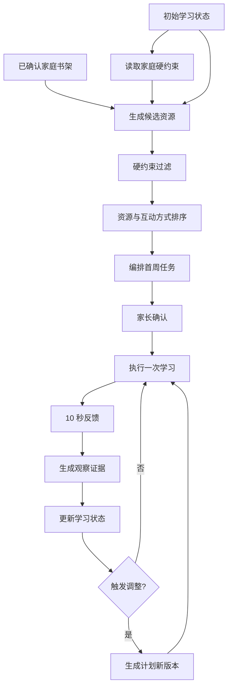

# 首周学习计划与动态调整设计 v0.1

> 适用范围：1.5～6 岁儿童英语绘本与早期分级阅读 MVP  
> 上游输入：`InitialLearningState`、家庭约束、已确认书架  
> 下游输出：版本化周计划、学习任务、家长反馈、状态更新与计划调整

## 1. 设计目标

首周计划不是一张固定课表。它同时承担四个目标：

1. 让家庭能够在已有时间和资源条件下开始执行；
2. 让孩子从可接受的内容与互动方式开始；
3. 通过真实共读补齐首次问卷无法确认的状态；
4. 根据家长反馈调整尚未执行的任务。

计划引擎不得以“完成更多书”为唯一目标。首周成功的判断包括：

- 家庭能够执行；
- 孩子没有因计划明显增加抵触；
- 系统获得了新的有效观察；
- 下一周的计划比第一周更贴合孩子。

## 2. 计划生成闭环



## 3. 输入要求

### 3.1 必需输入

- `learner_id`
- `stage_hypothesis`
- `primary_goal`
- `comfortable_duration`
- `family_available_days`
- `max_session_minutes`
- 至少一个已确认可用资源，或允许使用系列/套装级资源
- 内容安全约束

### 3.2 可选输入

- 次要目标
- 兴趣假设
- 偏好的互动方式
- 当前主分级体系与级别
- 已有熟悉资源
- 家长不希望安排的主题
- 常用点读设备
- 家长希望保留的固定内容

### 3.3 输入不足时的处理

| 缺少内容 | 处理方式 |
|---|---|
| 不知道兴趣 | 选择两个差异明显、年龄适配的资源做低压力观察 |
| 不知道舒适时长 | 从家庭允许时长的较短端开始，以孩子离开或抵触作为停止信号 |
| 没有单本清单 | 暂时按已确认套装安排，并请求家长在执行时选择具体单本 |
| 没有蓝思值 | 使用原生级别、年龄、篇幅、互动特征和真实表现，不伪造蓝思值 |
| 没有分级体系 | 仍可按绘本、童谣、认知主题和互动目标生成计划 |
| 关键状态不确定 | 安排观察型任务，不把未知当作不会 |

## 4. 计划编排原则

### 4.1 先满足硬约束

以下条件必须先过滤，不能通过评分抵消：

- 资源已由家长确认可用；
- 内容安全状态符合年龄要求；
- 单次建议时长不超过家庭上限；
- 不安排家长明确暂停或不希望使用的资源；
- 不依赖当前家庭没有的设备；
- 不要求孩子完成超出当前互动阶段的强制任务；
- 分级体系和资源来源不明确时，不宣称精确级别匹配。

### 4.2 熟悉内容与新内容同时存在

低龄儿童的重复阅读具有计划价值，不能因为“已经读过”就自动移除。

第一版采用可配置的起始比例：

| 阶段 | 熟悉或重复内容 | 新内容 | 说明 |
|---|---:|---:|---|
| 亲子共读启蒙 | 60%～80% | 20%～40% | 重复用于建立安全感、预期和参与 |
| 互动式共读 | 50%～70% | 30%～50% | 在熟悉故事中增加一点互动 |
| 早期文字意识 | 40%～60% | 40%～60% | 保留故事体验，增加语音或文字观察 |
| 早期分级阅读 | 30%～50% | 50%～70% | 复习读物与新读物并存 |

这些比例是 MVP 的启动配置，不是儿童教育标准。系统应根据家庭反馈逐步调整。

### 4.3 每次只增加一个主要挑战

一次任务不能同时增加：

- 更难的书；
- 更长的时间；
- 更多问题；
- 更高的表达要求；
- 更陌生的互动方式。

如果资源是新的，互动方式应尽量熟悉；如果互动目标是新的，优先使用熟悉资源。

### 4.4 每个任务只设置一个主要观察目标

例如：

- 是否愿意共同看书；
- 是否跟随动作；
- 是否根据提示指图；
- 是否主动要求重复；
- 是否补充重复句；
- 是否能按顺序说出两个情节；
- 是否能拼读目标模式。

任务可以自然出现其他行为，但家长不需要同时观察很多指标。

### 4.5 计划允许提前结束

建议时长是上限附近的参考，不是必须完成的指标。出现以下情况可以直接结束：

- 孩子持续离开；
- 明显烦躁或抵触；
- 家长需要强迫才能继续；
- 家庭临时有其他安排。

提前结束不能自动记为学习失败。

## 5. 任务类型

### 5.1 AnchorTask（熟悉锚点）

使用孩子已熟悉或明显偏好的资源，目标是提高执行稳定性并观察自然表现。

### 5.2 ExploreTask（新内容探索）

使用一个新的、风险较低的资源，观察主题、形式或内容适配度。

### 5.3 EvidenceTask（状态观察）

为了补齐某个重要证据缺口而设计，例如用熟悉的动作书观察孩子是否愿意模仿。

它不是测验，不要求孩子配合完成指定答案。

### 5.4 ReviewTask（复习与巩固）

适用于已经出现过的绘本、童谣、词汇、句型或早期阅读技能。

### 5.5 OptionalTask（可选任务）

用于家庭有额外时间或原任务不适合当天状态时替换。没有完成不计入计划缺口。

## 6. 单次学习任务结构

每个任务必须包含以下信息：

```json
{
  "task_id": "task_001",
  "task_role": "evidence",
  "scheduled_date": "2026-09-18",
  "resource_id": "resource_from_head_to_toe",
  "resource_title": "From Head to Toe",
  "suggested_duration_minutes": 8,
  "interaction_mode": "action_reading",
  "primary_goal": "increase_shared_reading_engagement",
  "observation_target": "action_imitation",
  "before_reading": "告诉孩子今天一起学动物做动作，不要求回答问题。",
  "during_reading": [
    "家长读到动作时先自己示范",
    "停顿几秒，等待孩子自行选择是否模仿",
    "孩子没有模仿时继续读，不重复要求"
  ],
  "after_reading": "如果孩子还想继续，可以重复最喜欢的两个动作。",
  "stopping_rule": "孩子连续离开或明显烦躁时结束。",
  "fallback": "只看三页并做一个动作也可以。",
  "recommendation_reasons": [
    "家庭书架中已确认可用",
    "匹配身体动作兴趣假设",
    "可以观察动作模仿"
  ]
}
```

### 6.1 家长界面展示

界面只展示家长真正需要的内容：

1. 今天读什么；
2. 大约多久；
3. 今天怎么互动；
4. 只需要留意什么；
5. 不配合时怎么办。

资源评分、规则编号和算法字段默认隐藏，但“为什么推荐”应当可以展开查看。

## 7. 候选资源生成

### 7.1 家庭书架优先

MVP 默认只从已确认家庭书架中生成候选。来源优先级：

1. 已确认在读或熟悉的单本；
2. 已确认未读的单本；
3. 已确认套装中可选择的内容；
4. 元数据不完整但由家长明确指定的资源。

状态为 `unknown`、`not_owned`、`paused` 的资源不自动进入计划。

### 7.2 资源适配维度

候选资源按以下维度排序：

- 发展阶段适配；
- 当前主要目标匹配；
- 家庭可用性；
- 内容与互动形式适配；
- 兴趣假设匹配；
- 熟悉度与重复需求；
- 主分级体系连续性；
- 当前待观察证据；
- 时长与篇幅适配；
- 元数据完整度和来源可靠性。

### 7.3 MVP 评分框架

```text
resource_fit =
    stage_fit
  + primary_goal_fit
  + interaction_fit
  + interest_fit
  + familiarity_value
  + evidence_value
  + level_continuity
  + metadata_confidence
  - duration_risk
  - complexity_risk
  - recent_overuse_risk
```

分值只用于候选排序，不向家长显示为教育测评分数。权重通过配置管理，并在试用后调整。

### 7.4 元数据不足的保守策略

- 蓝思值为空不阻止低龄共读资源进入计划；
- 套装缺少单本信息时不推断每本书的具体难度；
- 来源不明确的年龄建议只能作为弱证据；
- 图片中的分级对照不自动覆盖出版社或官方数据；
- 不确定资源可以由家长手动加入，但推荐解释要注明信息不足。

## 8. 周计划结构

```json
{
  "plan_id": "plan_001",
  "revision_id": "plan_001_r1",
  "learner_id": "learner_001",
  "period_start": "2026-09-18",
  "period_end": "2026-09-24",
  "primary_goal": "build_reading_habit",
  "planned_days": 5,
  "max_session_minutes": 10,
  "stage_hypothesis": "shared_reading_emergent",
  "task_ids": ["task_001", "task_002", "task_003", "task_004", "task_005"],
  "optional_task_ids": ["task_optional_001"],
  "evidence_goals": ["action_imitation", "pointing_response"],
  "status": "awaiting_parent_confirmation",
  "generation_model_version": "planner_v0.1"
}
```

### 8.1 计划状态

- `draft`：系统生成，尚未展示；
- `awaiting_parent_confirmation`：等待家长确认；
- `active`：当前执行版本；
- `superseded`：已被后续版本替代；
- `completed`：周期结束；
- `cancelled`：家长取消。

## 9. 各阶段首周编排模板

模板只决定任务角色和互动强度，不固定具体书名。

### 9.1 亲子共读启蒙

适用于主要通过听、看、翻页、触摸和动作参与的孩子。

5 次任务示例：

| 次序 | 任务角色 | 内容选择 | 主要观察 |
|---|---|---|---|
| 1 | 熟悉锚点 | 家长确认喜欢或熟悉的书 | 自然参与方式 |
| 2 | 新内容探索 | 同互动形式、不同主题 | 主题兴趣 |
| 3 | 重复巩固 | 重复第 1 或第 2 次中反应更好的内容 | 主动预期或重复请求 |
| 4 | 状态观察 | 熟悉内容中加入一个动作或指认机会 | 动作模仿或指认 |
| 5 | 熟悉锚点 | 本周反应最好的资源 | 是否仍愿意参与 |

### 9.2 互动式共读

| 次序 | 任务角色 | 内容选择 | 主要观察 |
|---|---|---|---|
| 1 | 熟悉锚点 | 熟悉故事 | 孩子自然回应方式 |
| 2 | 新内容探索 | 兴趣相近的新故事 | 新内容接受度 |
| 3 | 复习巩固 | 重复句或节奏明显的内容 | 补充词句或动作 |
| 4 | 状态观察 | 有明确人物和情节的熟悉故事 | 简单理解或预测 |
| 5 | 自主选择 | 让孩子从两个候选中选择 | 选择偏好与主动性 |

### 9.3 早期文字意识

| 次序 | 任务角色 | 内容选择 | 主要观察 |
|---|---|---|---|
| 1 | 熟悉锚点 | 熟悉绘本 | 是否主动关注文字 |
| 2 | 语音探索 | 童谣、押韵或重复句 | 节奏或语音参与 |
| 3 | 新内容探索 | 短篇新绘本 | 故事理解 |
| 4 | 状态观察 | 熟悉文字或标识较明显的内容 | 字母、词形或阅读方向意识 |
| 5 | 复习巩固 | 本周反应最好的内容 | 迁移或主动表达 |

### 9.4 早期分级阅读

| 次序 | 任务角色 | 内容选择 | 主要观察 |
|---|---|---|---|
| 1 | 级别验证 | 当前主体系中家长认为合适的内容 | 实际支持程度 |
| 2 | 复习巩固 | 已读过的同级内容 | 流利度和理解 |
| 3 | 新内容探索 | 同级新内容 | 新文本适配度 |
| 4 | 状态观察 | 目标语音、词汇或句型明显的内容 | 具体技能表现 |
| 5 | 平行拓展 | 同级或近似难度的辅助体系内容 | 跨资源迁移 |

## 10. 使用当前书架的示例计划

以下示例用于验证结构，不代表实际孩子的最终推荐。假设条件：

- 年龄：1.5 岁；
- 当前阶段：亲子共读启蒙；
- 主要目标：建立稳定共读习惯；
- 家庭可安排：每周 5 次，每次最多 10 分钟；
- 兴趣假设：身体动作、动物、童谣；
- 家长已确认相关绘本仍在家中。

| 天 | 资源 | 任务角色 | 建议互动 | 观察目标 |
|---|---|---|---|---|
| 第1天 | From Head to Toe | 状态观察 | 家长示范一个动物动作，等待孩子自行选择是否模仿 | 动作模仿 |
| 第2天 | Brown Bear Collection | 新内容探索 | 跟随图片说动物名称，不要求跟读 | 共同注意与动物兴趣 |
| 第3天 | From Head to Toe | 重复巩固 | 重复孩子前次最感兴趣的动作 | 主动预期或重复请求 |
| 第4天 | Open the Barn Door | 新内容探索 | 让孩子操作机关，家长配合说动物声音 | 翻页/机关互动与声音模仿 |
| 第5天 | 彩虹兔欢唱童谣1 | 熟悉锚点 | 选一首短童谣，家长跟节奏做动作 | 节奏参与与持续时间 |

可选替换：`I am a Bunny`、`Good Night Gorilla`、`My First Book of Words`。替换前仍需家长确认具体资源可用及孩子当日状态。

## 11. 家长确认计划

生成后，家长只需要确认以下内容：

- 本周学习天数是否可行；
- 每次时长是否可接受；
- 推荐资源是否确实在家；
- 是否有不希望使用的内容；
- 是否接受系统在权限范围内自动调整。

家长可以锁定某个任务。锁定后 Agent 不能自动替换，只能建议调整。

## 12. 10 秒反馈表单

### 12.1 必填项

#### F01 是否进行

- 完成
- 进行了一部分
- 今天没有进行

#### F02 大致持续多久

- 少于 3 分钟
- 3～5 分钟
- 5～10 分钟
- 10～15 分钟
- 15 分钟以上

当选择“今天没有进行”时不再询问时长。

#### F03 今天的参与情况

- 主动参与
- 有一些参与
- 主要在听或看
- 很快离开
- 明显抵触
- 不确定

### 12.2 快速行为标签

全部可选：

- 主动要求再读
- 主动翻页或操作
- 指认图片
- 模仿动作
- 模仿声音或单词
- 补充熟悉内容
- 回答或讲述
- 尝试看文字或自己读
- 后半段疲劳
- 需要大量引导

### 12.3 可选文字

> 还有什么想告诉学习助手？

Agent 将自然语言提取为观察候选，但保留原文，并在低置信度或高影响判断时请求家长确认。

## 13. 反馈到状态更新

### 13.1 转换过程

```text
反馈原文与选择项
  -> ParentFeedback
  -> 一条或多条 Observation
  -> ExposureEstimate / InterestEstimate / InteractionCapabilityEstimate
  -> AdjustmentTrigger
  -> PlanRevision 或保持原计划
```

### 13.2 更新原则

- 单次主动参与提高相关兴趣或熟悉度的短期估计，但不形成稳定标签；
- 单次没有模仿不能降低语言能力估计；
- 连续多次相似行为才提高阶段判断置信度；
- 未执行任务不更新孩子能力；
- 家长表示家庭时间冲突时只调整计划，不修改孩子状态；
- 家长主动纠正系统判断时，保留原判断和纠正记录。

## 14. 动态调整规则

### A-001 主动要求重复

```text
IF repeated_request = true
THEN
  将该资源加入未来 1～2 次任务的候选
  提高短期熟悉度和兴趣估计
  下次最多增加一个微小互动目标
```

### A-002 很快离开但无明显抵触

```text
IF engagement = left_quickly
   AND distress != true
THEN
  下次缩短建议时长
  使用更熟悉或互动更直接的资源
  不降低能力估计
```

### A-003 明显抵触

```text
IF engagement = resistant
THEN
  停止当天追加任务
  判断抵触是否与提问、时长、主题或身体状态相关
  后续任务降低互动要求或更换主题
```

### A-004 连续高参与

```text
IF 最近 3 次任务均为 active_or_some_engagement
   AND 无明显疲劳
THEN
  保持当前时长
  在熟悉资源中增加一个互动目标
  不自动明显提升文本难度
```

### A-005 当前分级偏难

```text
IF 最近 2 次同级任务均需要大量逐页帮助
   AND 家长反馈内容偏难
THEN
  暂停该级别的新内容
  安排已读内容或较低复杂度材料复核
  明显降级前请求家长确认
```

### A-006 当前分级偏易

```text
IF 最近 3 次同级新内容均能大部分独立完成
   AND 基本理解表现稳定
THEN
  加入 1 个相邻级别验证任务
  验证成功前不整体升级
```

### A-007 当天未进行

```text
IF completion = not_started
THEN
  不生成能力或兴趣负向证据
  根据家庭原因改期、取消或保持为空
  不把未完成任务持续累积成欠账
```

### A-008 孩子表现与问卷不一致

```text
IF 真实活动证据与 InitialLearningState 明显冲突
THEN
  提高真实活动证据权重
  降低相关初始判断置信度
  生成新的状态版本
  若影响发展阶段或分级范围，请家长确认
```

## 15. 计划版本机制

### 15.1 不修改历史

- 已完成任务保持原始计划内容；
- 已记录反馈保持原文；
- 调整只作用于尚未执行的任务；
- 每次调整生成新的 `PlanRevision`；
- 新旧版本记录触发证据和采用的规则。

### 15.2 调整记录

```json
{
  "adjustment_id": "adjustment_001",
  "from_revision_id": "plan_001_r1",
  "to_revision_id": "plan_001_r2",
  "trigger_observation_ids": ["obs_101", "obs_102"],
  "rule_ids": ["A-001"],
  "operations": [
    {
      "type": "repeat_resource",
      "resource_id": "resource_from_head_to_toe",
      "target_date": "2026-09-20"
    }
  ],
  "requires_parent_confirmation": false,
  "explanation": "孩子主动要求重复，因此保留该书，并只增加一个动作等待互动。"
}
```

## 16. 自动调整权限

### 16.1 可自动执行

- 在家庭可用日期内改期；
- 重复孩子主动要求的内容；
- 将建议时长小幅缩短；
- 同复杂度、同目标下更换主题；
- 在熟悉资源中增加一个低压力互动；
- 删除未执行的可选任务。

### 16.2 需要家长确认

- 增加每周学习总时长；
- 明显提升或降低分级；
- 切换主分级体系；
- 使用未确认拥有的资源；
- 改变阶段目标；
- 改变发展阶段主判断；
- 恢复家长暂停或锁定的资源。

## 17. 数据模型补充

### WeeklyPlan

- `plan_id`
- `learner_id`
- `period_start/end`
- `primary_goal_id`
- `stage_snapshot_id`
- `current_revision_id`
- `status`

### PlanRevision

- `revision_id`
- `plan_id`
- `revision_number`
- `trigger_type`
- `trigger_evidence_ids`
- `created_at`
- `requires_parent_confirmation`
- `decision_status`

### LearningTask

- `task_id`
- `revision_id`
- `task_role`
- `resource_id`
- `scheduled_date`
- `suggested_duration_minutes`
- `interaction_mode`
- `primary_goal`
- `observation_target`
- `instruction_payload`
- `stopping_rule`
- `fallback_payload`
- `recommendation_reason_codes`
- `status`
- `locked_by_parent`

### TaskFeedback

- `feedback_id`
- `task_id`
- `completion`
- `duration_band`
- `engagement`
- `behavior_tags`
- `original_text`
- `submitted_at`
- `structured_by_model`
- `confirmed_by_parent`

## 18. API 草案

```text
POST /learners/{learner_id}/weekly-plans/generate
GET  /weekly-plans/{plan_id}
POST /weekly-plans/{plan_id}/confirm
POST /weekly-plans/{plan_id}/constraints

GET  /tasks/{task_id}
POST /tasks/{task_id}/start
POST /tasks/{task_id}/feedback
POST /tasks/{task_id}/skip
POST /tasks/{task_id}/lock

POST /weekly-plans/{plan_id}/simulate-adjustment
POST /weekly-plans/{plan_id}/revisions
GET  /weekly-plans/{plan_id}/adjustments
POST /adjustments/{adjustment_id}/decision
```

计划生成和调整接口必须返回：

- 使用的状态版本；
- 使用的资源版本；
- 触发规则；
- 推荐理由；
- 是否需要家长确认。

## 19. 验收场景

### S-001 低龄重复阅读

孩子连续要求重复 `From Head to Toe`。系统保留重复任务，增加动作等待互动，不强制换新书。

### S-002 兴趣与疲劳区分

孩子前半段参与、后半段离开。系统先缩短时长，不直接判断主题不感兴趣或能力不足。

### S-003 当天未学习

家庭临时有事。系统改期或取消任务，不降低任何学习状态。

### S-004 套装未拆分

书架只有“红火箭蓝盒”。系统允许家长从套装中选择一本，但不伪造具体单本难度。

### S-005 分级验证

家长填写 RAZ B。系统先安排当前级别验证任务，不能仅凭家长填写直接认定稳定适读。

### S-006 跨体系补充

主体系为牛津树。系统保持牛津树连续性，仅用 RAZ 或红火箭做同目标巩固和兴趣补充。

### S-007 家长锁定任务

家长锁定睡前固定读物。Agent 可以建议，但不能自动替换。

### S-008 问卷与真实表现冲突

问卷判断为互动共读，真实活动连续显示孩子更适合低压力亲子朗读。系统生成新状态版本，并请求家长确认阶段调整。

## 20. 实施顺序

1. 将当前 Excel 与文本书单整理为标准化候选书架。
2. 为已有资源补充计划所需的最小元数据。
3. 实现基于规则的候选资源过滤和排序。
4. 实现 `WeeklyPlan`、`LearningTask` 与 `TaskFeedback` 数据结构。
5. 实现 10 秒反馈到 Observation 的转换。
6. 实现 A-001、A-002、A-007、A-008 四条首批规则。
7. 用真实家庭数据完成一周试运行，再调整比例、问题和反馈字段。

